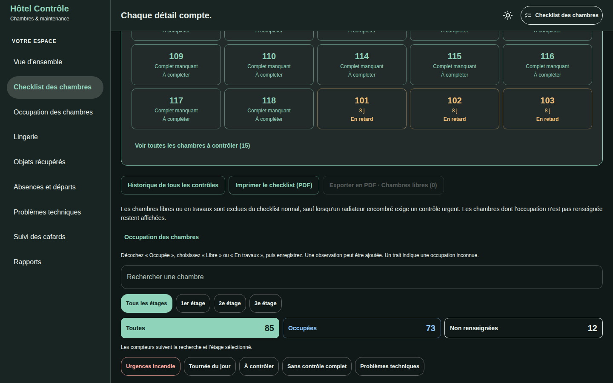
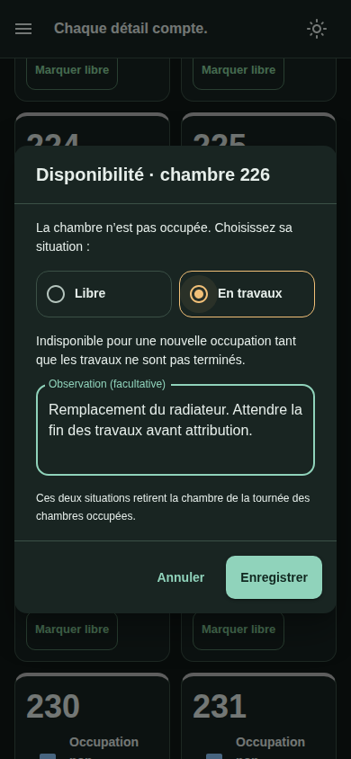
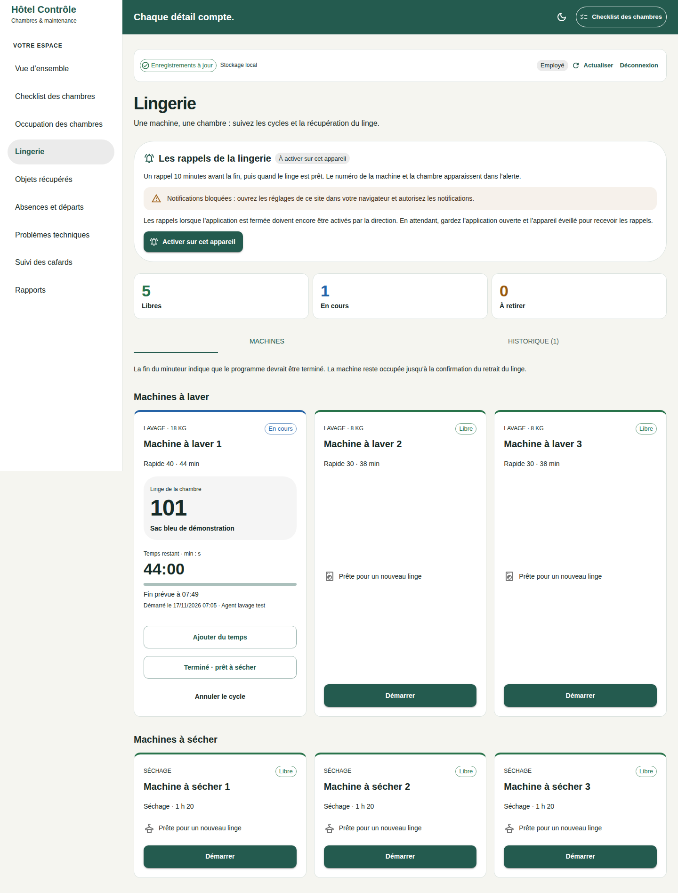
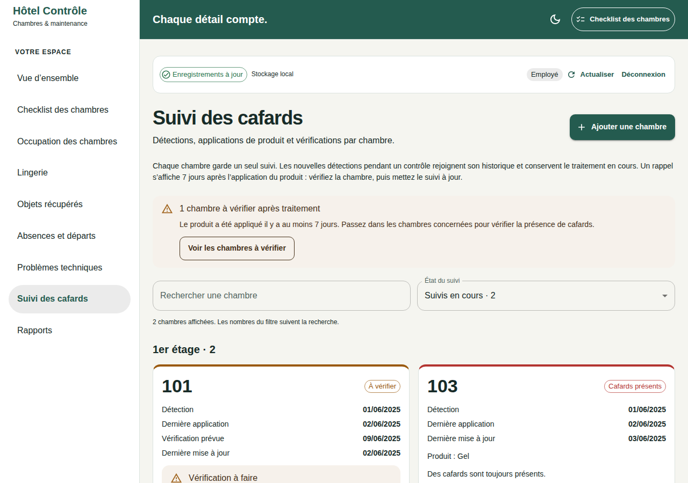
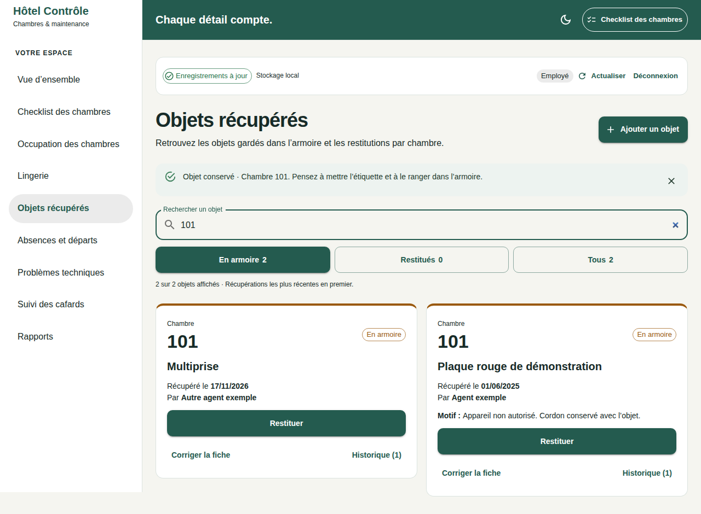
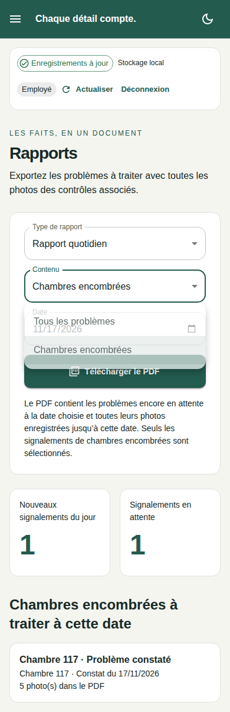
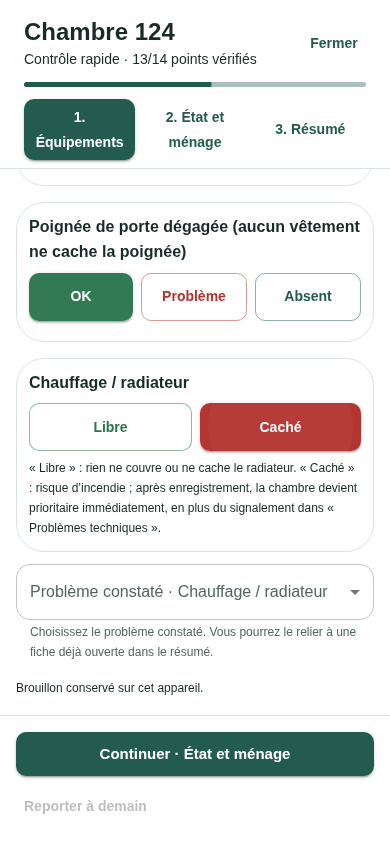

# Hôtel Contrôle

### Une seule application pour suivre les chambres, les interventions et les tâches du quotidien.

**Pensé pour les hôtels, résidences et structures d'hébergement qui ont besoin d'un suivi simple, clair et partagé.**

Fini les informations dispersées entre carnets, messages et tableaux : Hôtel Contrôle aide les équipes à savoir **quelles chambres vérifier, quels problèmes restent ouverts et ce qui a déjà été fait**. L'application s'utilise sur **téléphone, tablette ou ordinateur**, en français.

> **Une question suffit pour commencer : qu'est-ce qui doit être fait aujourd'hui ?**
>
> Le tableau de bord et les listes de suivi donnent une réponse lisible à toute l'équipe.

[**Ouvrir l'application (accès réservé)**](https://hotel-esby-fawn.vercel.app/) · [**Découvrir les écrans**](#découvrez-lapplication-en-images) · [**Voir les fonctionnalités**](#tout-le-suivi-dun-hôtel-au-même-endroit)

---

## En pratique : une journée, sans papier perdu

**1. Le matin :** ouvrez **Checklist des chambres**. L'application propose une tournée en tenant compte des chambres jamais contrôlées, des contrôles en retard et des visites prioritaires. Les chambres libres et en travaux ne figurent pas dans la tournée normale.

**2. Pendant la visite :** choisissez des réponses simples (**OK**, **Problème**, **Oui**, **Non**), ajoutez une remarque et, si nécessaire, prenez jusqu'à **3 photos par contrôle**. Les problèmes techniques sont suivis sans multiplier les doublons.

Dans le **Résumé**, associez chaque défaut déjà signalé à sa fiche de la chambre. Si la fiche contient plusieurs problèmes, choisissez l’élément contrôlé. **Toujours présent** conserve le suivi ouvert. Avec l’accès **Direction**, **Résolu** consigne la réparation et le résultat OK de cet équipement. Par exemple, si la chasse d’eau fonctionne de nouveau mais que le radiateur reste caché, indiquez les deux résultats dans la même visite. La chambre reste prioritaire pour le radiateur.

Le résumé permet de relire les associations avant l’envoi. L’historique et la fiche imprimée conservent l’état constaté lors de cette visite. En cas de coupure, le contrôle et ses photos restent en attente sur l’appareil. Si une fiche a changé entre-temps, ouvrez l’envoi à vérifier, relisez la fiche et confirmez votre choix pour reprendre la saisie.

**3. Au fil de la journée :** retrouvez les interventions, le suivi des cafards, les machines de la lingerie, les objets conservés et les mouvements des familles dans leurs espaces dédiés.

**4. Pour transmettre :** ouvrez **Rapports**, choisissez une période et téléchargez un **PDF avec les constatations et leurs photos**, prêt à partager ou à imprimer.

## Découvrez l'application en images

*Captures réelles de l'interface, réalisées pendant des tests avec des données fictives. Elles illustrent le fonctionnement et ne présentent aucune information de résident réel. Cliquez sur une image pour l'agrandir.*

### 1. Des tournées de chambres organisées

**Ce que vous voyez :** les chambres à vérifier, celles en retard, la recherche par numéro et les raccourcis pour continuer la tournée. Les contrôles déjà effectués sont conservés dans l'historique.

### 2. Une occupation compréhensible au premier regard

**Ce que vous voyez :** une case cochée signifie **Occupée**. Si la chambre est vide, l'équipe choisit **Libre** (disponible) ou **En travaux** (indisponible) et peut ajouter une observation. Les filtres évitent de confondre une chambre vide avec une chambre prête à accueillir quelqu'un.

### 3. La lingerie suivie machine par machine

**Ce que vous voyez :** les machines disponibles ou occupées, la chambre à laquelle appartient le linge et le temps restant. L'équipe peut ajouter des minutes si le programme n'est pas terminé et confirmer le retrait avant de libérer la machine. Des rappels sont possibles sur les appareils compatibles, après configuration.

### 4. Un seul suivi des cafards par chambre

**Ce que vous voyez :** les chambres concernées, les dates de détection et de traitement, les observations et les vérifications à réaliser. Les nouvelles observations rejoignent l'historique du même dossier, plutôt que de créer plusieurs fiches contradictoires.

### 5. Les objets récupérés restent identifiables

**Ce que vous voyez :** le numéro de chambre, l'objet, la personne qui l'a récupéré et son état de restitution. Même un objet sans numéro de chambre connu peut être enregistré puis identifié plus tard.

### 6. Des rapports avec les photos des constats

Dans **Rapports**, choisissez un jour ou un mois, puis le contenu du PDF. Vous pouvez isoler les **problèmes techniques**, les **chambres encombrées** ou les **problèmes résolus**. Le **rapport complet** réunit les problèmes encore à traiter à la fin de la période et ceux résolus pendant celle-ci. Les photos des visites liées à un même signalement sont regroupées.

### 7. Les situations de sécurité sont signalées clairement

**Ce que vous voyez :** le contrôle du radiateur, avec les réponses **Libre** ou **Caché**. Un radiateur obstrué constitue une situation à sécuriser sans attendre : l'application le signale comme une **priorité urgente**, distincte du suivi habituel à quatre jours pour un mauvais état général.

---

## Tout le suivi d'un hôtel au même endroit

| Espace | À quoi sert-il ? |
| --- | --- |
| **Vue d'ensemble** | Repérer rapidement les informations utiles pour la journée. |
| **Checklist des chambres** | Organiser les visites, consigner l'état du mobilier et des équipements, ajouter des photos et retrouver les contrôles. |
| **Occupation des chambres** | Distinguer **Occupée**, **Libre** et **En travaux**, avec une observation facultative. |
| **Problèmes techniques** | Consulter les pannes et les réparations. Le filtre Cafards ouvre le suivi existant de chaque chambre. |
| **État général de chambre** | Retrouver les remarques sur les chambres encombrées, y compris celles déjà enregistrées, avec leurs photos et leur historique. Pour ajouter un constat, cochez **Oui** à **Chambre encombrée d’affaires** dans la checklist. Le filtre **Résolu** permet de retrouver les constats clôturés. |
| **Suivi des cafards** | Conserver les détections, les traitements et les vérifications dans le même dossier par chambre. |
| **Lingerie** | Suivre les lave-linge et sèche-linge, leur temps restant et le retrait des vêtements. |
| **Objets récupérés** | Noter la collecte, la conservation et la restitution d'un objet. |
| **Absences et départs** | Enregistrer les événements des familles et conserver les commentaires dans l'historique. |
| **Rapports** | Exporter des rapports PDF avec les dates, les constatations et les photos disponibles. |

### Ce qui facilite le travail des équipes

- **Simple à utiliser :** gros boutons, réponses courtes, recherche par chambre et présentation adaptée au téléphone.
- **Une information partagée :** les collègues peuvent consulter le même suivi et voir les dernières mises à jour enregistrées.
- **Moins de doublons :** un défaut déjà signalé peut être réutilisé dans un nouveau contrôle au lieu de créer une autre fiche.
- **Un historique utile :** dates, personnes ayant enregistré les actions, observations et photos permettent de comprendre ce qui s'est passé.
- **Priorités de sécurité :** les radiateurs encombrés restent signalés jusqu'à une nouvelle vérification indiquant qu'ils sont dégagés. Les chambres en mauvais état général reviennent dans la rotation après quatre jours.
- **Un mode sombre :** pour une lecture plus confortable selon les conditions de travail.
- **En cas de coupure réseau :** une saisie peut rester en attente sur l'appareil et être envoyée au retour de la connexion. L'interface distingue clairement une saisie **en attente** d'un enregistrement **confirmé**.

## Pour qui ?

**Pour les agents :** savoir quelle chambre contrôler, noter rapidement les anomalies et retrouver les informations utiles sans chercher dans plusieurs fichiers.

**Pour les responsables :** disposer d'une vue d'ensemble, suivre les problèmes non résolus, vérifier l'historique et préparer un rapport pour la direction ou les partenaires.

Les accès **Employé** et **Direction** disposent de droits différents afin de réserver certaines modifications aux responsables.

## Comment découvrir le logiciel ?

1. **Présentation guidée :** une visite des écrans et d'un exemple de journée de travail.
2. **Démonstration avec données fictives :** voir comment un contrôle, une photo et un problème technique arrivent jusqu'au rapport.
3. **Adaptation à votre établissement :** examiner ensemble les chambres, les machines, les procédures internes et les profils d'accès à configurer.
4. **Mise en service :** préparer les accès, le stockage des données et l'accompagnement de l'équipe avant toute utilisation réelle.

L'application actuelle est configurée pour un établissement donné : **son installation dans un autre hôtel demande une adaptation et une configuration préalables**. Les machines, les listes de chambres et les règles de travail présentées ici sont des exemples du fonctionnement existant.

### Informations importantes avant toute utilisation réelle

L'application utilise des accès protégés et des services Google pour conserver des données et des photos. Un futur établissement doit définir qui peut y accéder, les règles de conservation, les autorisations et les mesures de confidentialité applicables. **Une démonstration ne doit pas utiliser les données personnelles de résidents réels sans autorisation.**

Les chronomètres de lingerie indiquent un **temps prévu** : ils ne commandent pas les machines physiques. Les alertes et les suivis **ne remplacent pas** les procédures de sécurité de l'établissement, les contrôles humains ni un dispositif d'alarme incendie.

---

**Vous gérez un hôtel ou une résidence et souhaitez voir Hôtel Contrôle en fonctionnement ?** Une démonstration et un périmètre d'adaptation peuvent être préparés pour votre équipe.

Hôtel Contrôle — présentation fonctionnelle. Les captures utilisent uniquement des données fictives. Pour les notes de maintenance et de déploiement destinées aux techniciens, voir le [dossier technique](docs/NOTES-TECHNIQUES.md).

**Déploiement des contrôles de chambre.** En mode Google Sheets, publier le script et activer le service Sheets v4 avant de mettre à jour l’application. [Procédure de publication et de reprise](docs/NOTES-TECHNIQUES.md#publication-de-la-synchronisation-des-contrôles-de-chambre)

